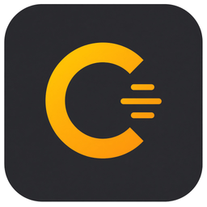

# Cadence

**Steady your AI coding practice.**

Local-first insights for Copilot, Claude Code, Codex, Cursor, and OpenCode — right inside VS Code / Cursor.  
Cadence reads the session logs you already have, surfaces habits worth fixing, and never phones home.

<p align="center">
  <a href="https://marketplace.visualstudio.com/items?itemName=badrusiddique.cadence-insights"></a>
  
  
  
  
</p>

<p align="center">
  
</p>

```text
  Observe  →  Measure  →  Improve  →  Level Up
  sessions    charts      signals     practice
```

## Get started in 2 minutes

### Option A — Install from the Marketplace (recommended)

1. In VS Code or Cursor, open **Extensions**
2. Search **Cadence** (publisher `badrusiddique`)  
   or open: [Marketplace listing](https://marketplace.visualstudio.com/items?itemName=badrusiddique.cadence-insights)
3. **Install** → reload if asked
4. **Command Palette → `Cadence: Open Overview`**
5. No local logs yet? Enable **Settings → `cadence.demoMode`**

### Option B — Install a VSIX from source

```bash
git clone https://github.com/badrusiddique/cadence.git
cd cadence
npm ci
npm run package
code --install-extension cadence-insights-1.1.0.vsix
# or: cursor --install-extension cadence-insights-1.1.0.vsix
```

On Windows PowerShell, if `npm` is blocked by execution policy:

```powershell
Set-ExecutionPolicy -Scope Process -ExecutionPolicy Bypass
# or use Command Prompt / npm.cmd
```

### Option C — Preview the UI in a browser (no extension install)

```bash
npm ci
npm run preview
```

Open [http://127.0.0.1:43127](http://127.0.0.1:43127) — fixture data, full dashboard.

More detail: **[docs/GETTING_STARTED.md](docs/GETTING_STARTED.md)**

---

## What you get

| Pillar | What it does |
|---|---|
| **Observe** | Dashboard, day-grouped timeline, coding moments |
| **Measure** | Output (8 chart modes), burndown estimates, patterns, curiosity, flow, hub |
| **Improve** | 45 habit signals, Rule Studio, Signal Lab, skill finder, context health |
| **Level Up** | Practice drills, achievements, lifecycle mix, shareable snapshot |
| **Agents** | CLI + stdio MCP + `@cadence` chat + LM tools |

**Why people adopt it**

- Works offline — no cloud coaching account  
- Burndown is **on** (clearly labeled as estimates, not billing)  
- Cursor + Claude + Codex + Copilot + OpenCode in one view  
- Adapt loop you can trust: Lab → Save draft → **Approve** → load  

## Quick workflows

**Human**

1. Open Overview  
2. Filter: Current / All · date range · harness  
3. Check Anti-Patterns → open Rule Studio if you want a custom signal  
4. Export Snapshot when you want a shareable weekly card  

**Agent / automation**

```bash
npm run cli -- doctor --json
npm run cli -- overview --demo --json
npm run cli -- habits --demo --json
npm run mcp                  # stdio MCP
npm run setup:mcp            # dry-run registration
```

Chat in-editor: `@cadence /summary` · `/habits` · `/compare` · `/flow`

---

## Supported harnesses

| Harness | Typical path |
|---|---|
| VS Code / Copilot chat | `.../User/workspaceStorage/*/chatSessions` |
| Cursor | `workspaceStorage` + `~/.cursor/projects/**` |
| Copilot CLI | `~/.copilot/session-state` |
| Claude Code | `~/.claude/projects/**/*.jsonl` |
| Codex CLI | `~/.codex/sessions/**/*.jsonl` |
| OpenCode | `~/.local/share/opencode` |

All reads are **read-only**. Cadence never mutates session files.

## Privacy & trust

- Local analysis only — no proprietary telemetry  
- Personal signals under `~/.cadence/signals` require **explicit Approve** before they load  
- Lab predicates use a sandboxed expression parser (no `eval` / `Function`)  
- Enterprise defaults: offline webview CSP, RPC allowlist, ingest caps, optional export redaction  
- Details: [SECURITY.md](SECURITY.md) · [docs/ENTERPRISE.md](docs/ENTERPRISE.md) · [docs/SIGNALS.md](docs/SIGNALS.md)

## Develop

```bash
npm ci
npm run check      # typecheck + lint + test
npm run build
npm run preview
npm run package    # cadence-insights-1.1.0.vsix
```

| Path | Role |
|---|---|
| `src/ingest/` | Discover + parse harness logs (capped) |
| `src/analyze/` | Analytics used by UI + LM tools |
| `src/signals/` | Habit SignalSpec engine + catalog |
| `src/ui/` | Preact dashboard (offline fonts) |
| `src/host/` | Panel, RPC guard, chat, tools |
| `src/cli/` · `src/mcp/` | Doctor, overview, MCP server |

## Docs

| Doc | Purpose |
|---|---|
| [Getting started](docs/GETTING_STARTED.md) | Install, first session, demo mode |
| [Enterprise](docs/ENTERPRISE.md) | Org rollout, privacy controls, admin checklist |
| [Signals](docs/SIGNALS.md) | Author + adapt habit rules |
| [Marketplace](docs/MARKETPLACE.md) | Publish to VS Marketplace / Open VSX |
| [Architecture](docs/ARCHITECTURE.md) | How the pieces fit |
| [QA vs AEC](docs/QA-AEC-VS-CADENCE.md) | Honest comparison notes |
| [NOTICE](NOTICE) | Prior art disclosure |

## Commands

- `Cadence: Open Overview`  
- `Cadence: Reload Sessions`  
- `Cadence: Export Snapshot`  
- `Cadence: Review Local Signals`  

## License

[MIT](LICENSE) © Badru Siddique  

Original product in the same problem space as Microsoft’s MIT-licensed [AI Engineering Coach](https://github.com/microsoft/ai-engineering-coach) — see [NOTICE](NOTICE). Not a fork.
