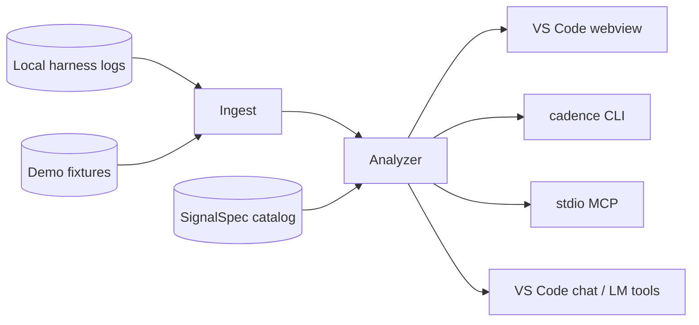

# Cadence architecture

## Surfaces

Cadence shares one analytics core across extension, CLI, and MCP — the same dual-surface idea popularized for agent tooling by [REA](https://github.com/morluto/rea) (MIT), adapted here for session insights rather than binary reverse engineering.

## Reverse-engineering notes (prior art)

Two public MIT projects informed the problem space and engineering bar:

1. **[microsoft/ai-engineering-coach](https://github.com/microsoft/ai-engineering-coach)** — VS Code dashboard over local AI session logs (parsers, anti-pattern DSL, Preact webview, chat tools). Cadence reimplements the *capability surface* with original code, IA, and branding.
2. **[morluto/rea](https://github.com/morluto/rea)** — MCP/CLI for reverse engineering. Cadence does **not** copy REA’s binary tooling. We adopted REA’s *process* quality bar: evidence provenance, doctor probes, compact MCP schemas, agent skills, and CLI↔host parity.

### REA static analysis of AI Engineer Coach (2026-10-22)

Ran `rea-agents analyze-javascript-application` against a local clone. Observed (artifact-bytes / AST) highlights:

| Fact | Evidence |
|---|---|
| Package `ai-engineer-coach` main `./dist/extension.js` | `package.json` observation |
| Dominant modules under `src/core` then `src/webview` | path frequency in graph (~2016 / ~716 refs) |
| Also `src/canvas`, `src/mcp`, `src/chat` | path frequency |
| Worker: `cache-write-worker.js` via `worker_threads` | graph `worker` node |
| 272 parsed JS files, 0 parse failures | statistics |
| Not an Electron app (IPC/preload counts = 0) | summary |
| Static analysis limitations apply | REA limitations list |

Cadence mirrors the *roles* (ingest workers, analyzer facade, webview RPC, chat/MCP) without reusing source.

## Bounded contexts

| Path | Responsibility |
|---|---|
| `src/ingest/` | Discover trusted roots; parse harnesses → `Session[]` |
| `src/analyze/` | Pure queries over sessions |
| `src/signals/` | Habit SignalSpec engine + catalog |
| `src/ui/` | Preact dashboard |
| `src/host/` | VS Code panel, chat, LM tools |
| `src/cli/` | Doctor + overview/habits/export |
| `src/mcp/` | Stdio MCP tool server |

## Privacy

- Read-only logs  
- Local-only analysis  
- No proprietary telemetry  
- Budget figures carry `evidence.authority = estimate`
